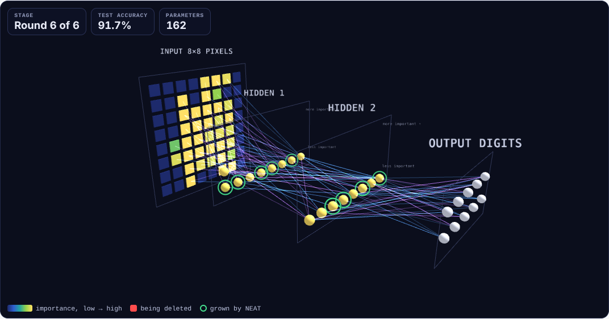
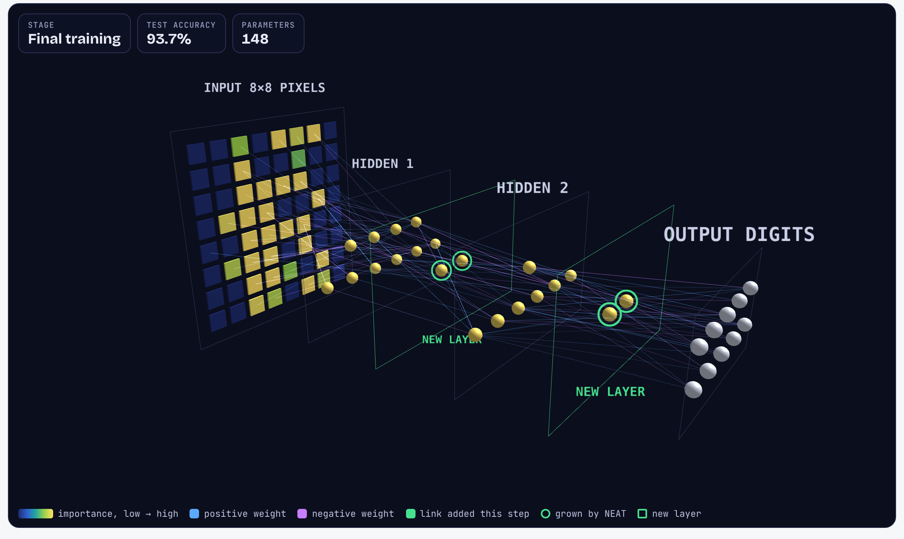
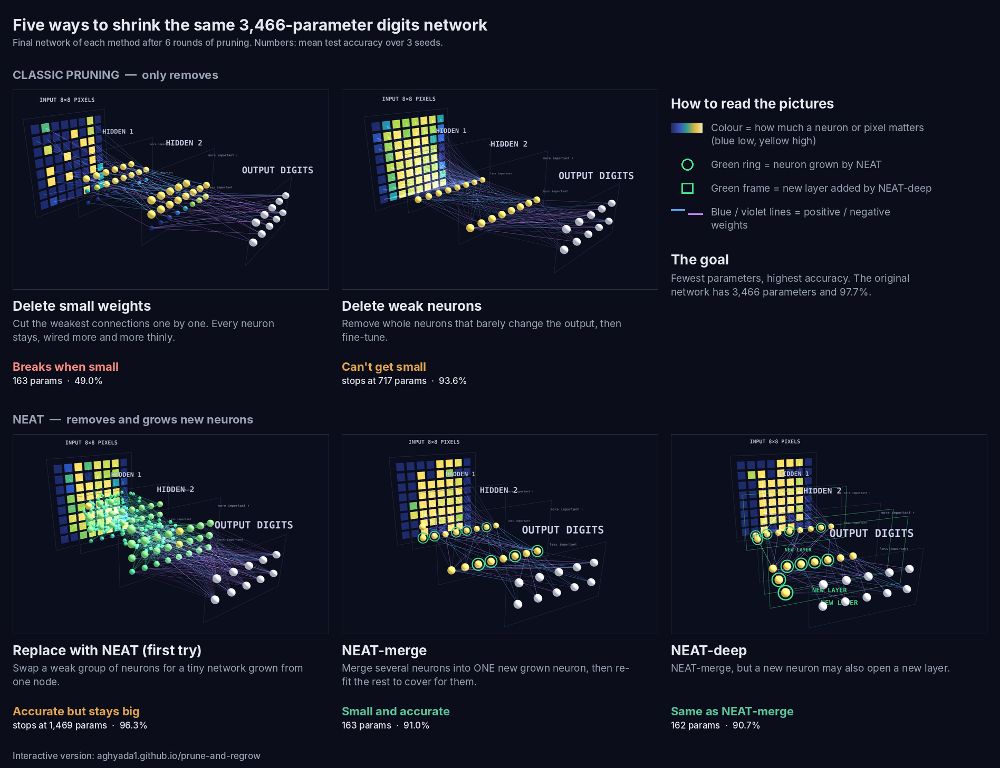

# Prune and Regrow

A side project to **see** how different ways of shrinking a neural network actually work. Each method is applied to the same small digits network and replayed step by step in 3D, so you can watch which neurons and links get removed, which get grown, and what that does to accuracy.

The goal is understanding and comparison, not a state-of-the-art result. The network and dataset are deliberately tiny so every neuron fits on screen. Even so, the side-by-side comparison shows clear differences: at about 160 parameters, NEAT-merge keeps 91% accuracy where deleting small weights drops to 49%.

## ▶ Live demos

Open them in a browser, press **Play**, and drag to rotate the network.

<table>
<tr>
<td width="50%" align="center">
<a href="https://aghyada1.github.io/prune-and-regrow/prune-and-regrow.html"></a><br>
<b><a href="https://aghyada1.github.io/prune-and-regrow/prune-and-regrow.html">Prune and Regrow →</a></b><br>
Five pruning methods take the same network from 3,466 parameters down to ~160, round by round.
</td>
<td width="50%" align="center">
<a href="https://aghyada1.github.io/prune-and-regrow/distill/best-student.html"></a><br>
<b><a href="https://aghyada1.github.io/prune-and-regrow/distill/best-student.html">Distilled NEAT student →</a></b><br>
NEAT evolves a 148-parameter student (93.7%) that learns to copy the original network, over 40 generations.
</td>
</tr>
</table>

## The five methods at a glance



| | method | what it does | final size | accuracy |
|---|---|---|---|---|
| ✂️ | **Delete small weights** | cuts the weakest connections | 163 params | 49.0% ❌ breaks |
| ✂️ | **Delete weak neurons** | removes whole neurons that barely matter | stops at 717 | 93.6% ⚠️ can't get small |
| 🌱 | **NEAT, first try** | replaces weak neuron groups with tiny grown networks | stops at 1,469 | 96.3% ⚠️ stays big |
| 🌱 | **NEAT-merge** | merges many neurons into one grown neuron, re-fits the rest | **163 params** | **91.0%** ✅ |
| 🌱 | **NEAT-deep** | NEAT-merge that can also add layers | 162 params | 90.7% (same as merge) |

✂️ only removes · 🌱 removes and grows. Start: 3,466 parameters, 97.7%. All numbers are the mean of 3 seeds.

## How NEAT-merge works

1. **Merge:** replace a few weak neurons with ONE new neuron. It starts with a single input link and adds links one at a time while they help (NEAT-style growth).
2. **Re-fit:** re-solve the next layer's weights by least squares, so it still receives almost the same signal as before.
3. **Choose:** among all possible changes (merge, delete a neuron, trim weak links), apply the one that loses the least accuracy per parameter saved.

**Distillation** (`distill/`): instead of learning only from labels, the small student learns to copy the original network's output probabilities. NEAT chooses the student's wiring under a hard parameter cap.

## Setup and caveats

A 64-32-32-10 MLP on scikit-learn's 8x8 digits (3,466 parameters, 97.7%), cut down in six rounds with the same fine-tuning budget for every method, so the comparison is fair. The test set is 540 images, so one image is 0.19 points and differences under about a point are noise. It runs on a laptop CPU. The numbers show how the methods behave relative to each other on this toy setup; they are not a benchmark.

## Detailed results

Pruning (mean test accuracy over 3 seeds, from `summary.json`):

| method | ~460 params | ~285 params | ~160 params |
|---|---|---|---|
| Delete small weights | 85.6 | 77.8 | 49.0 |
| NEAT-merge, no new neurons (ablation) | 95.5 | 94.1 | 87.5 |
| **NEAT-merge** | **96.5** | **95.1** | **91.0** |
| NEAT-deep (new layers) | 95.7 | 94.8 | 90.7 |

Deleting weak neurons cannot get this small: it stops at 717 parameters and 93.6%.

Distillation (from `distill/README.md`):

| student | params | acc % |
|---|---|---|
| original network | 3466 | 97.7 |
| NEAT-merge smallest net | 163 | 91.0 |
| **NEAT from that net, distilled, cap 150** | **149** | **93.3** |
| same 163-param net, just trained longer | 163 | 93.4 |
| 163-param net with weakest links cut to 120 (no NEAT) | 119 | 83.6 |
| NEAT from that net, distilled, cap 120 | 120 | 91.1 |

## What I learned

- **Re-fitting is what makes NEAT-merge work.** After each change, the next layer's weights are re-solved so it still gets nearly the same signal. Without new neurons the same search is just as good down to about 290 parameters; growing new neurons pays off only at the smallest size (91.0% vs 87.5%).
- **New layers did not help.** NEAT-deep uses them (the recorded run ends with 5 hidden layers) but lands within seed noise of the flat version. On this task the limit seems to be how many pixel links survive, not depth.
- **Most of the distillation gain was longer training.** The 163-parameter net reaches 93.4% just by training longer. What NEAT plus distillation adds is the same accuracy with fewer parameters, and 91.1% at 120 parameters where plain link cutting drops to 83.6%.
- **Tiny fixed networks train badly from scratch** (36 to 75% at this size). NEAT avoids this because each child keeps its parent's trained weights.

## Run it

```bash
pip install -r requirements.txt
python3 compare.py                 # classic pruning vs first NEAT version, ~10 min
python3 neat_merge.py full3_look   # NEAT-merge winner, 3 seeds
python3 neat_deep.py deep          # NEAT-deep
cd distill && python3 distill.py 0 1 2 && python3 summarize.py   # ~45 min per seed
```

`demo.py` is the first toy experiment (needs matplotlib for `heatmap.png`). Per-seed partial outputs and logs are in `runs/`. The 3D pages are self-contained HTML; they load three.js from a CDN.

## Layout

```
compare.py, neat_merge.py, neat_deep.py   pruning experiments (each imports the one before)
*.json                                    their results
prune-and-regrow.html                     3D replay and write-up of the pruning experiments
distill/                                  NEAT + distillation, its own README and 3D replay
runs/                                     per-seed partial outputs and run logs
screenshots/                              stills from the 3D pages
```

## License

MIT
